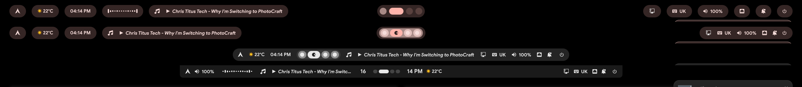
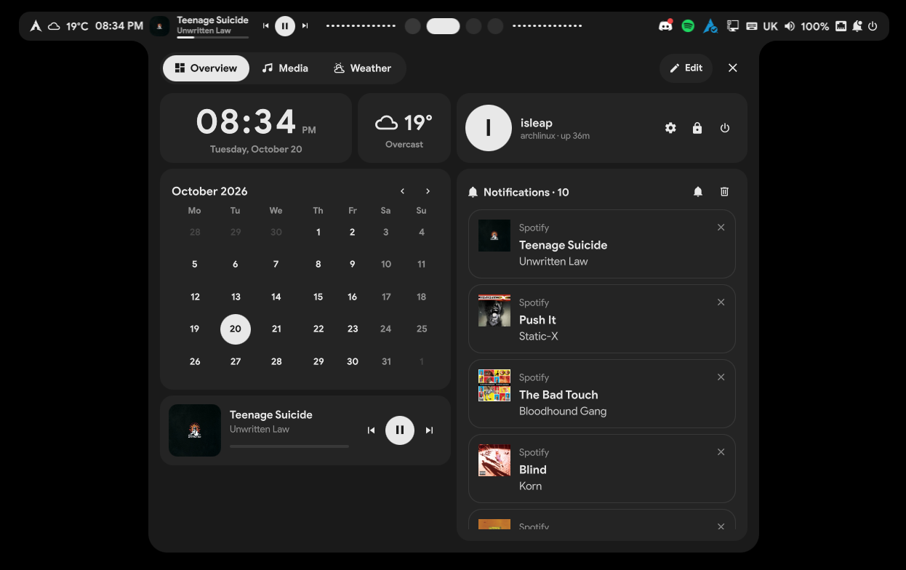
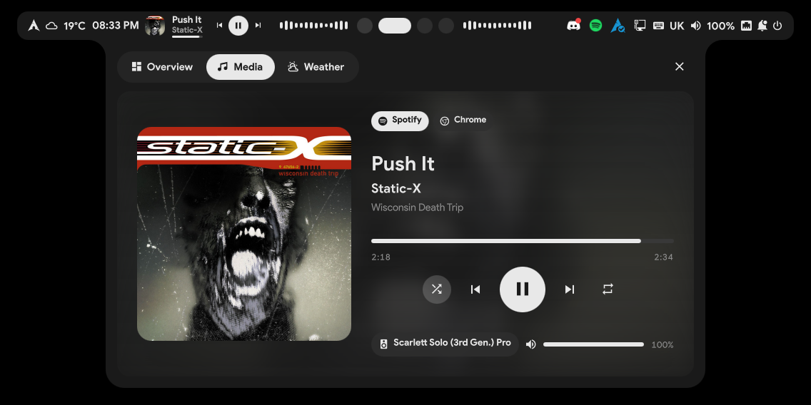
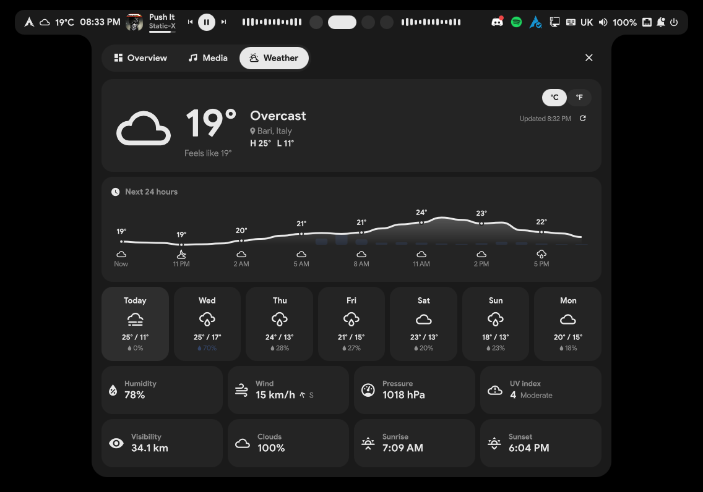
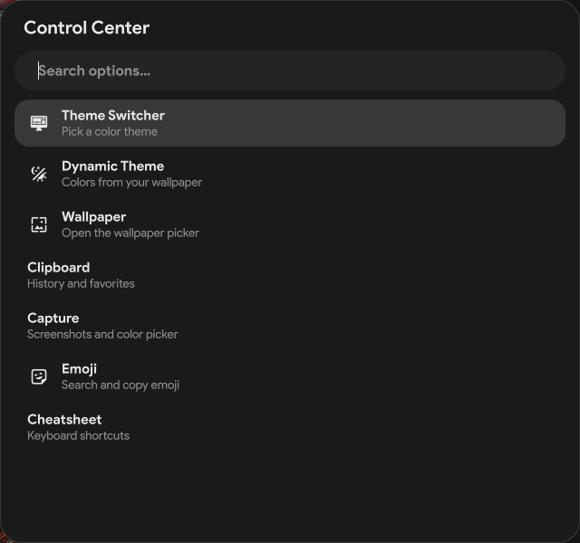
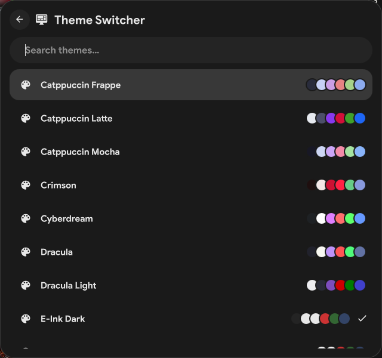
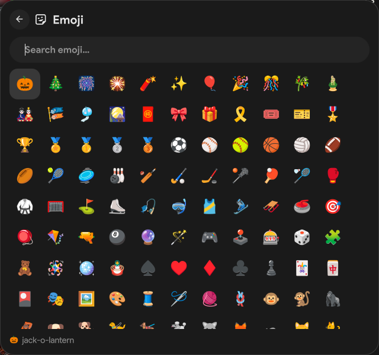
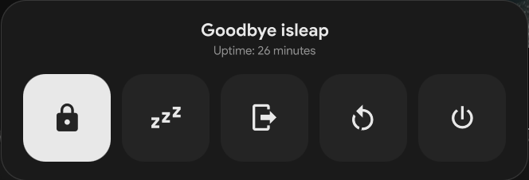
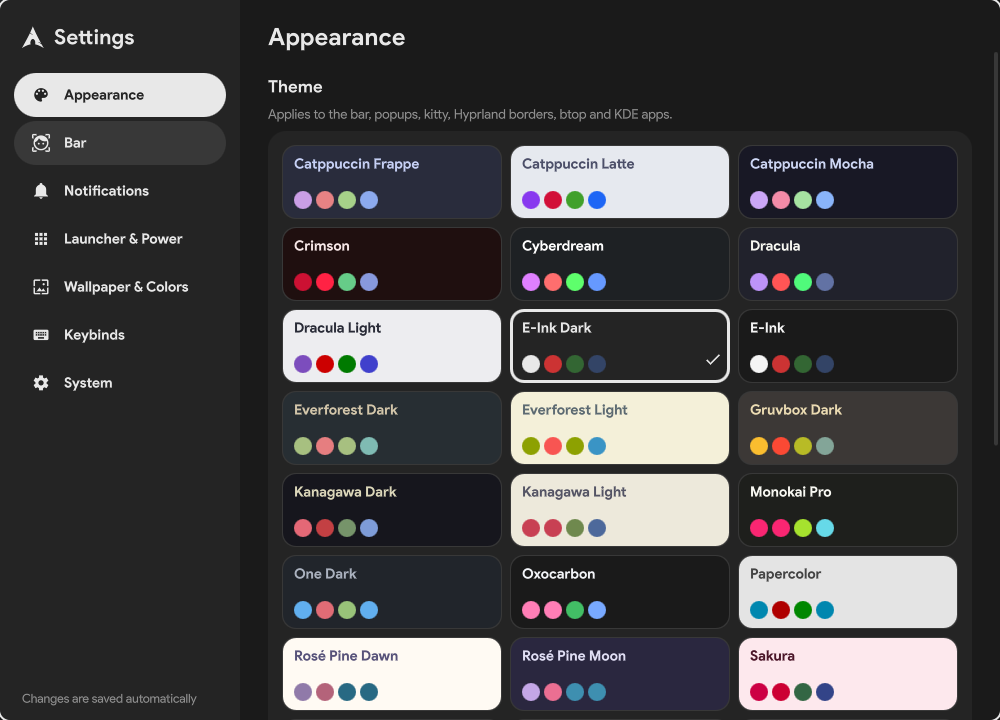
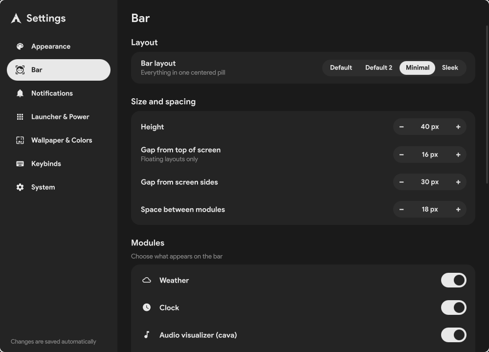

# 🌸 isleap's dotfiles

A Hyprland rice with a **from-scratch Quickshell desktop**: bar, app launcher, notifications, power menu, control center and a full Settings app. Pick from 24 color themes, or let the colors follow your wallpaper with matugen.

> Hyprland is configured in **Lua** (Hyprland 0.55+). There is no `hyprland.conf`.

---

## 📸 Preview


<p align="center"><i>The four bar layouts: Default, Default 2, Minimal and Sleek</i></p>


<p align="center"><i>The dashboard (<code>Super + A</code> or click the clock), growing out of the bar</i></p>

| Dashboard: media | Dashboard: weather |
|---|---|
|  |  |

| Control center | Themes |
|---|---|
|  |  |
| **Emoji picker** | **Power menu** |
|  |  |

| Settings app |
|---|
|  |
|  |

---

## 🖥️ What's inside

| | |
|---|---|
| **OS** | Arch Linux |
| **Window manager** | Hyprland (Lua config) |
| **Desktop shell** | [Quickshell](https://quickshell.org) — bar, launcher, notifications, power menu, control center, settings (all in `config/quickshell`) |
| **Wallpaper** | awww + [qs-wallpaper-picker](https://github.com/magetsu002/qs-wallpaper-picker) |
| **Colors** | 24 hand-made themes, or matugen (Material You from the wallpaper) |
| **Terminal / shell** | kitty + fish + starship |
| **Editor** | micro |
| **Files** | Dolphin, with Gwenview (images), Okular (PDF), Ark (archives), mpv (video/audio) |
| **Updates** | [arch-update](https://github.com/Antiz96/arch-update) (tray icon + notifications) |
| **Lock screen** | [qylock](https://github.com/Darkkal44/qylock) — Material You Dark (Quickshell, PAM) |
| **Login screen** | SDDM with the same qylock Material You Dark theme |
| **Idle** | hypridle: dim 2.5 min → lock 5 min → screens off 5.5 min → suspend 30 min |
| **Cursor** | Bibata-Modern-Ice |
| **GPU** | NVIDIA RTX 5070 (`nvidia-open`) — the installer handles other GPUs too |

---

## 🚀 Install

On a fresh Arch Linux install (with a user account, internet and `git`):

```bash
git clone https://github.com/isleap9/isleap-dotfiles.git ~/GitHub/isleap-dotfiles
cd ~/GitHub/isleap-dotfiles
./install.sh
```

Then **reboot** and log into Hyprland. That's it.

The script asks three questions at the start (apps, NVIDIA driver, login screen) and then runs on its own. Run it as your normal user — it asks for your password when needed. It's safe to run again.

<details>
<summary><b>What install.sh does</b></summary>

1. Installs `yay` (AUR helper) if it's missing
2. Installs every package below (official repos + AUR)
3. Moves any existing configs it would replace to `~/.config-backup-<date>/`
4. Copies `config/` → `~/.config/` and `local/share/` → `~/.local/share/`
5. Copies the wallpapers to `~/Pictures/Wallpapers`
6. Installs qs-wallpaper-picker (pinned version + this repo's settings and small patch) and the qylock lock screen (only the Material themes, pinned version)
7. Creates the home folders (Documents, Music, Videos…) and sets up Dolphin: kitty as terminal, thumbnails for everything, folders in the sidebar, a working **Open With** menu
8. Sets GTK apps to dark mode with Breeze icons
9. Enables NetworkManager, Bluetooth, power profiles, the keyring, arch-update's update checks, and SDDM if you chose it

</details>

<details>
<summary><b>NVIDIA</b></summary>

RTX 50 series (Blackwell) cards **only** work with NVIDIA's open kernel modules, which is what the installer uses:

| Package | Why |
|---|---|
| `nvidia-open` | driver for the stock `linux` kernel (`nvidia-open-dkms` + headers is picked automatically for `linux-zen`, `linux-lts`, …) |
| `nvidia-utils`, `nvidia-settings` | driver tools |
| `libva-nvidia-driver` | hardware video decoding (browsers, mpv) |
| `lib32-nvidia-utils` | 32-bit driver for Steam / games (only if multilib is enabled) |

Recent drivers turn on `nvidia_drm.modeset` and `fbdev` by default, so no kernel parameters are needed. Check with:
```bash
cat /sys/module/nvidia_drm/parameters/modeset   # should print Y
```
No NVIDIA card? The installer comments out the NVIDIA variables in `~/.config/hypr/modules/env.lua` for you.

</details>

### After installing

- **Monitors:** `~/.config/hypr/modules/monitors.lua` is set for my two screens (DP-2 1080p 165 Hz + DP-3 1440p 180 Hz). Change it, or run `nwg-displays`.
- **Weather city:** Settings (`Super + ,`) → Bar → Weather city.
- **Video wallpapers** work out of the box (`mpvpaper` is installed).
- **Lock screen theme:** put another qylock theme name in `~/.config/qylock/theme` (`material-you` is the light version).
- **Login screen theme:** `./setup/sddm-theme.sh material-you` switches SDDM to the light version (or back with no argument).

<details>
<summary><b>Package list</b> (the installer installs all of this)</summary>

```
# Hyprland and Wayland basics
hyprland hypridle hyprpicker hyprshot grim slurp uwsm
qt6-5compat qt6-svg   # for the qylock lock screen
xdg-desktop-portal-hyprland xdg-desktop-portal-kde xdg-desktop-portal-gtk
polkit-kde-agent qt5-wayland qt6-wayland

# Quickshell
quickshell qt6-multimedia qt6-multimedia-ffmpeg cava playerctl

# Wallpaper and colors
awww imagemagick ffmpeg matugen-bin (AUR) mpvpaper (AUR)

# Terminal and shell
kitty fish starship micro fastfetch btop

# Dolphin and file apps
dolphin kio-extras kio-admin kde-cli-tools archlinux-xdg-menu plasma-integration breeze breeze-icons
gwenview okular ark 7zip unrar unzip mpv
kimageformats qt6-imageformats ffmpegthumbs kdegraphics-thumbnailers ffmpegthumbnailer

# Clipboard and emoji
wl-clipboard wl-clip-persist cliphist rofimoji

# Audio, network, bluetooth, power
pipewire pipewire-alsa pipewire-jack pipewire-pulse wireplumber libpulse pavucontrol
networkmanager network-manager-applet bluez bluez-utils brightnessctl power-profiles-daemon

# System
gnome-keyring seahorse xdg-user-dirs xdg-utils udisks2 libnotify jq curl wget git python glib2
arch-update (AUR)

# Fonts and cursor
ttf-jetbrains-mono-nerd ttf-firacode-nerd ttf-nerd-fonts-symbols otf-font-awesome
noto-fonts noto-fonts-cjk noto-fonts-emoji ttf-google-sans (AUR) ttf-rubik-vf (AUR)
bibata-cursor-theme (AUR)

# Optional apps (the installer asks)
google-chrome firefox visual-studio-code-bin github-desktop-bin discord
```

</details>

---

## ⌨️ Keybinds

| Keys | Action |
|---|---|
| `Super + Space` | App launcher |
| `Super + T` | Terminal (kitty) |
| `Super + E` | Files (Dolphin) |
| `Super + B` | Browser (Chrome) |
| `Super + C` | VS Code |
| `Super + Q` | Close window |
| `Super + M` | Power menu |
| `Super + Shift + L` | Lock screen |
| `Super + N` | Notification center |
| `Super + A` | Dashboard |
| `Super + ,` | Settings |
| `Super + .` | Emoji picker |
| `Super + Shift + E` | Control center |
| `Super + Shift + T` | Theme switcher |
| `Super + Shift + W` | Wallpaper picker |
| `Super + Shift + C` | Clipboard history |
| `Super + Shift + V` | Capture menu (region / screen / window / color) |
| `Super + Shift + S` | Screenshot a region |
| `Super + Shift + P` | Color picker |
| `Super + R` | Restart Quickshell |
| `Super + W` | Toggle floating |
| `Super + F` / `Super + Shift + F` | Maximize / true fullscreen |
| `Super + S` | Scratchpad |
| `Super + J / L / I / K` | Move focus left / right / up / down |
| `Super + 1–0` | Switch workspace |
| `Super + Shift + 1–0` | Move window to workspace |
| `Super + scroll` | Cycle workspaces |

Also: right-click the Arch logo on the bar for the control center, and right-click the bell for Do Not Disturb.

---

## 🧩 The Quickshell desktop

Everything lives in `~/.config/quickshell`. It reloads by itself when you save a file.

- **Bar** — five bars to choose from: the four fixed layouts from my old Waybar setup (Default, Default 2, Minimal, Sleek) and a **Custom** bar that's fully editable in Settings, Noctalia-style: left / center / right lanes of widgets you can add, remove, reorder and configure, top or bottom, floating pills or a solid bar. Custom starts as a copy of Default, and "Start over from…" resets it to any of the Waybar layouts. The Custom bar's look is editable too: background color and opacity, border, pill roundness, density, text/icon/accent colors, text and icon size, text weight, and per-widget color overrides. Three styles: separate pills, one floating bar (with an adjustable gap), or one bar attached to the screen edge (with optional curved outer corners); the one-piece bars can fit the widgets or span the full width. Widgets: app launcher, workspaces, clock (with calendar), weather, now playing (cover, title, artist, progress and buttons, like the dashboard), cava visualizer, tray, keyboard layout, volume, network, notifications, power, control center, settings, screenshot, spacer.
- **App launcher** — type to search, arrows + Enter to launch.
- **Notifications** — popups with action buttons, a notification center, Do Not Disturb.
- **Power menu** — lock, suspend, logout, reboot, shutdown (asks before acting).
- **Dashboard** (`Super + A`, or click the clock; click the weather for the forecast) — inspired by [DankMaterialShell](https://github.com/AvengeMedia/DankMaterialShell)'s. **Overview**: cards on a 6-column grid (clock, weather, calendar, now playing, notifications, user — click the picture to change it —, CPU, memory, GPU, disk, network) that you can reorder, resize, add and remove with Edit. **Media**: big player over a blurred cover, seek bar, shuffle/repeat, player and audio-output pickers, volume. **Weather**: now, a 24-hour chart, 7 days and details (humidity, wind, pressure, UV, visibility, clouds, sunrise/sunset), °C/°F. Weather comes from Open-Meteo, the same data the bar's weather widget uses. With a one-piece bar (Floating or Attached), the dashboard grows out of the bar itself: same color, no gap, curved corners where they meet.
- **Control center** (`Super + Shift + E`) — bar layout, theme switcher, dynamic colors, wallpaper, clipboard (history + favorites + image previews), capture, emoji, cheatsheet.
- **Settings app** (`Super + ,`, or search "Quickshell Settings") — theme, fonts, the bar editor, **monitors** (main monitor, bar per monitor, popups on the main or focused monitor), notifications, launcher, power menu, wallpaper colors. Saved to `~/.config/quickshell/config.json`, applied instantly.

Everything can also be scripted:
```bash
qs ipc call launcher toggle
qs ipc call controlcenter open clipboard     # main, themes, dynamic, clipboard, capture, emoji, cheatsheet, barlayout
qs ipc call settings open bar                # appearance, bar, monitors, notifications, launcher, wallpaper, keybinds, system
qs ipc call bar layout sleek                 # default, default2, minimal, sleek
qs ipc call notifications toggleDnd
```

---

## 🎨 Theming

Two systems that work side by side:

**Static themes** (`Super + Shift + T`) — 24 hand-made themes: One Dark, Catppuccin (Mocha, Frappé, Latte), Gruvbox Dark, Rosé Pine (Moon, Dawn), Tokyo Night / Day, Monokai Pro, Cyberdream, Oxocarbon, Dracula / Dracula Light, Kanagawa Dark / Light, Everforest Dark / Light, Crimson, Sakura, Papercolor, Sleepy, E-Ink / E-Ink Dark.

**Dynamic colors** (Settings → Wallpaper & Colors) — when on, every wallpaper you pick generates a Material You palette with matugen. Choose dark/light and one of 9 scheme styles.

Both recolor: the Quickshell desktop, kitty, Hyprland borders, btop, and Dolphin/KDE apps.

**How it works:** each app reads an `active` symlink in its themes folder. A static theme points them at hand-made files; dynamic mode points them at `dynamic.*` files that matugen regenerates on every wallpaper change. Quickshell reads its colors from `~/.config/waybar/themes/active.css` (the folder name is left over from Waybar).

```
wallpaper picked → matugen palette → dynamic.css / .conf / .lua / .colors → symlinks → apps reload
```

---

## 📂 Dolphin

Set up to work like a full desktop file manager without KDE Plasma:

- **Open With** lists all apps (fixed with `archlinux-xdg-menu`)
- Right-click: **Extract / Compress** (Ark), **Open as Administrator**, **Open in Kitty**, **Set as Wallpaper**
- Thumbnails for videos, PDFs, ebooks, fonts, RAW photos, big GIFs
- Sidebar with Desktop, Documents, Downloads, Music, Pictures, Videos, Projects, GitHub, dotfiles, Config, Wallpapers, Screenshots
- Open/Save dialogs in other apps (Chrome…) use the KDE dialog too
- Default apps: images → Gwenview, PDF → Okular, archives → Ark, video/audio → mpv, text/code → micro

---

## 🔄 Updating this repo

After changing configs on your machine:
```bash
./sync.sh
```
It copies everything into the repo (removed files are removed here too). Then review and commit in GitHub Desktop.

---

## 📁 Structure

```
isleap-dotfiles/
├── install.sh                  # Set up everything on a fresh Arch install
├── sync.sh                     # Copy configs from this machine into the repo
├── config/                     # → ~/.config
│   ├── hypr/                   # Hyprland (Lua): hyprland.lua + modules/, scripts/, hyprlock, hypridle
│   ├── quickshell/             # The desktop shell
│   │   ├── shell.qml           # Entry point
│   │   ├── bar/                # Bar, its 4 layouts and modules
│   │   ├── launcher/           # App launcher
│   │   ├── notifications/      # Popups + notification center
│   │   ├── powermenu/          # Power menu
│   │   ├── controlcenter/      # Control center pages
│   │   ├── settings/           # Settings app
│   │   ├── components/         # Shared widgets
│   │   ├── scripts/            # launch.sh, wallpaper picker + hooks
│   │   ├── Theme.qml           # Colors (from the active theme)
│   │   ├── Config.qml          # Settings (saved in config.json)
│   │   └── config.json         # Your settings
│   ├── qylock/                 # Which lock screen theme to use
│   ├── waybar/                 # Only theme files + theme-switcher.sh + weather.py (used by Quickshell)
│   ├── kitty/  fish/  starship.toml  fastfetch/  btop/
│   ├── matugen/                # Dynamic color templates
│   ├── cliphist/               # Clipboard favorites
│   ├── gtk-3.0/  gtk-4.0/      # GTK dark mode + icons
│   ├── xdg-desktop-portal/     # KDE file dialogs
│   └── mimeapps.list           # Default apps
├── local/share/                # → ~/.local/share
│   ├── applications/           # arch-update (opens in kitty), Quickshell Settings
│   ├── kio/servicemenus/       # Dolphin right-click: Open in Kitty, Set as Wallpaper
│   └── color-schemes/          # KDE color schemes for Dolphin and Qt apps
├── extras/qs-wallpaper-picker/ # Picker settings, local patch, pinned version
├── extras/qylock/             # Small fix for the lock screen theme (Enter unlocks)
├── setup/dolphin-places.py     # Adds folders to Dolphin's sidebar
├── setup/sddm-theme.sh        # Login screen theme (SDDM)
├── Wallpapers/                 # → ~/Pictures/Wallpapers
└── screenshots/
```

---

## 🙏 Credits

- [Quickshell](https://quickshell.org) — the toolkit the whole desktop is built with
- [qs-wallpaper-picker](https://github.com/magetsu002/qs-wallpaper-picker) by Magetsu
- [arch-update](https://github.com/Antiz96/arch-update) by Antiz96
- [qylock](https://github.com/Darkkal44/qylock) by Darkkal44 — lock screen themes
- [matugen](https://github.com/InioX/matugen) — Material You colors
